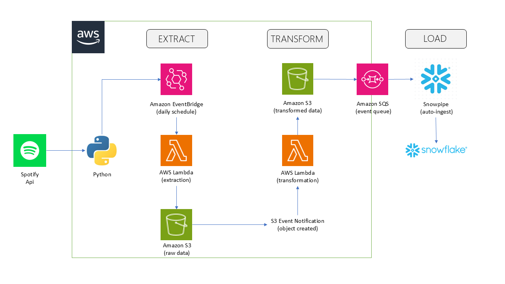

# Spotify ETL & Snowflake Analytics Pipeline


An end-to-end, event-driven data pipeline that extracts music catalog data from the Spotify Web API, transforms it using serverless AWS Lambda functions, and loads it into Snowflake for analytics — fully automated from source to warehouse.

## Architecture



*Spotify Web API → Python → Amazon EventBridge (daily schedule) → AWS Lambda (extraction) → Amazon S3 (raw data) → AWS Lambda (transformation) → Amazon S3 (transformed data) → Amazon SQS (event queue) → Snowpipe (auto-ingest) → Snowflake (MUSIC_CATALOG).*

The pipeline is fully serverless and event-driven end to end — no manual intervention required between extraction and the data landing in Snowflake.

## Tech stack

| Layer | Tool | Purpose |
|---|---|---|
| Extraction | Python, `spotipy` | Pulls artist/album/track metadata via Spotify Web API (Client Credentials Flow) |
| Compute | AWS Lambda | Two serverless functions — extraction and transformation |
| Scheduling | Amazon EventBridge | Triggers extraction on a daily schedule |
| Storage | Amazon S3 | Data lake — raw and transformed zones |
| Transformation | `pandas` | Cleans, flattens, and deduplicates raw JSON into structured CSVs |
| Event routing | S3 Event Notifications, SQS | Chains extraction → transformation, and notifies Snowflake of new files |
| Warehouse | Snowflake | Stores curated, queryable tables (`ARTISTS`, `ALBUMS`, `TRACKS`) |
| Ingestion | Snowpipe | Auto-loads new S3 files into Snowflake continuously |
| Access control | AWS IAM | Scoped, credential-based access from Snowflake to S3 |

## Snowflake objects

| Object | Name |
|---|---|
| Database | `MUSIC_CATALOG` |
| Schema | `CATALOG_DATA` |
| Tables | `ARTISTS`, `ALBUMS`, `TRACKS` |
| Warehouse | `COMPUTE_WH` (X-Small, auto-suspend) |
| File Format | `CSV_FORMAT` |
| Stages | `ARTISTS_STAGE`, `ALBUMS_STAGE`, `TRACKS_STAGE` |
| Pipes | `ARTISTS_PIPE`, `ALBUMS_PIPE`, `TRACKS_PIPE` |

## Project structure

```
spotify-etl-snowflake-pipeline/
├── .env.example
├── .gitignore
├── README.md
├── requirements.txt
│
├── 01_lambda/
│   ├── extraction/
│   │   └── lambda_function.py
│   └── transformation/
│       └── lambda_function.py
│
├── 02_snowflake/
│   ├── 01_setup/
│   │   ├── 01_create_database_schema.sql
│   │   ├── 02_create_tables.sql
│   │   └── 03_create_stage_with_credentials.sql
│   ├── 02_load/
│   │   ├── 04_test_copy_into.sql
│   │   └── 05_create_snowpipes.sql
│   └── 03_validation/
│       └── 06_row_count_checks.sql
│
├── 03_notebooks/
│   └── S_Data_Pipeline.ipynb
│
└── 04_docs/
    ├── architecture-diagram.pptx
    └── architecture-diagram.png
```

## Design decisions & challenges

**Credential-based stage over Storage Integration**
Snowflake was hosted in an AWS opt-in region, which caused a persistent `sts:AssumeRole` failure when setting up a Storage Integration — the trust relationship couldn't be established without Snowflake-side support for that region. Rather than block the project on a support ticket, the pipeline uses a credential-based external stage (IAM access key/secret scoped to a single S3 bucket) instead. This is a reasonable tradeoff for a project of this scale, with the tradeoff being manual key rotation instead of Snowflake-managed trust.

**Least-privilege IAM**
The IAM user used by Snowflake is scoped to read-only access on a single S3 bucket, rather than broad or administrative permissions — following the same principle learned earlier in the project when a Lambda execution role initially lacked `s3:PutObject` and had to be explicitly granted.

**No automatic deduplication (known limitation)**
`COPY INTO` and Snowpipe track *which files* have been loaded, not *which rows*. If the same artist or track appears across multiple extraction runs, it can be inserted more than once, since Snowflake does not enforce the `PRIMARY KEY` constraint declared on these tables. Duplicates were identified and removed via a `ROW_NUMBER()` dedup pass. A production version of this pipeline would land data in a staging table and use `MERGE` (upsert) logic instead of `COPY INTO` directly into the final tables — noted here as a planned improvement.

## Setup

1. Create a Spotify Developer app at `developer.spotify.com/dashboard` (Client Credentials Flow — no user login required)
2. Deploy the two Lambda functions in `01_lambda/`, with an EventBridge rule for daily scheduling and an S3 event trigger chaining extraction → transformation
3. Run the SQL scripts in `02_snowflake/01_setup/` through `02_snowflake/02_load/` in order, using your own IAM credentials in place of the placeholders
4. Configure S3 Event Notifications on each `transformed_data/` subfolder, pointing at the corresponding Snowpipe's SQS notification channel
5. Run `02_snowflake/03_validation/06_row_count_checks.sql` to confirm the load

## Future improvements

- Replace `COPY INTO` + manual dedup with a staging table + `MERGE` upsert pattern
- Migrate from EventBridge's simple scheduling to Airflow for orchestration
- Add SCD (slowly changing dimension) tracking for artist/track metadata changes over time
- Add data freshness / SLA monitoring